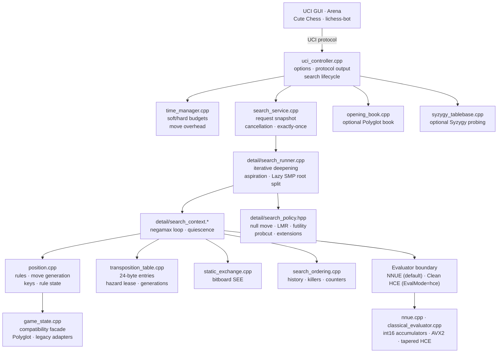

# System architecture

This page maps Koi's runtime modules to the files under `src/koi`. It is a
module map, not a call graph: solid arrows show the main data and control
direction, and every node names a real translation unit or header.

## Components

| File | Responsibility |
| --- | --- |
| `uci_controller.cpp` | Owns the current position and the search-worker lifecycle; the only layer that writes UCI output. |
| `search_service.cpp` | Public search lifecycle boundary: request snapshot, cancellation, exactly-once completion. |
| `detail/search_session.cpp` | One immutable request, worker ownership, cancellation/ponderhit timer, completion claim. |
| `detail/root_fallback.*` | Bounded root-fallback policy: emergency static/one-ply scanners used when a short search cannot complete an authoritative iteration. |
| `detail/search_worker_pools.hpp` | Lazy-SMP helper pool and root-parallel worker pool: worker lifetime, abort/failure capture, live statistics. |
| `detail/search_stats_support.hpp` | Shared per-worker `SearchStats` merge used by pools and the serial driver. |
| `detail/fen_validation.*` | Stateless FEN syntax validation used before the native position and mirror are built. |
| `detail/game_state_impl.hpp`, `detail/native_check_probe.hpp` | Private `GameState::Impl` and the position-invariant move-check probe inputs. |
| `detail/consistency.*` | Native/shadow consistency diagnostic snapshot builder, friended by `GameState`. |
| `detail/uci_option_table.hpp` | UCI option catalog (order, defaults, bounds, combo values) consumed by handshake and setoption. |
| `detail/debug_log.*` | Best-effort developer debug log (JSON lines, rotation); never on UCI stdout. |
| `hash_types.hpp` | Public hash policy/result value types shared by `SearchService` and `TranspositionTable` without exposing TT storage. |
| `completion_gate.cpp` | Legality/PV/searchmoves validation before a bestmove is published. |
| `detail/search_runner.cpp` | Backend dispatch, iterative deepening, aspiration windows, Lazy SMP and root-parallel scheduling. |
| `detail/search_context.*` | Search-local recursive state: move loop, quiescence, pruning call sites, fixed-capacity stack. |
| `detail/search_policy.hpp` | Centralized scalar gates: null move, late-move reductions, futility, probcut, check extensions. |
| `position.cpp` | Production authority for legality, position keys, rule state, and move generation. |
| `game_state.cpp` | Compatibility facade used by the evaluator, search, and UCI APIs; keeps its private mirror synchronized. |
| `transposition_table.cpp` | Physical storage, locking, generations, clearing, resizing, and mate-score normalization. |
| `static_exchange.cpp` | Bitboard static-exchange evaluation used by pruning and ordering. |
| `search_ordering.cpp` | History, killers, and continuation counters for move ordering. |
| `nnue.cpp` | Default/production evaluator: NNUE container, inference and incremental state. |
| `classical_evaluator.*` | Clean hand-crafted evaluator (HCE rewrite): stateless, tapered, selectable with `EvalMode=hce`/`KOI_EVALUATOR=hce`. |
| `opening_book.cpp` | Optional Polyglot opening book; release packages bundle a CC0 book, the repository commits none. |
| `syzygy_tablebase.cpp` | Optional Syzygy root and interior probing; no tablebase data is bundled. |
| `time_manager.cpp` | Soft/hard time budgets, move-overhead subtraction, and flag-proof ceilings. |

## Optional layers

- `src/koi/modules/` — the optional C++26 named-module partitions (`types`,
  `position`, `eval`, `tablebase`, `search`, `runtime`).
- `src/koi/detail/` — private implementation headers and units that do not
  establish a public ABI.

## Hand-crafted evaluator (HCE)

The clean HCE is an optional evaluator, not a second production default:

- `classical_evaluator.{hpp,cpp}` implements the existing `Evaluator` interface;
  it is stateless and advertises concurrent evaluation.
- It derives its own board/attack/mobility state from
  `GameState::copy_board_to` and the native attack tables; it does **not** use
  the shared NNUE `PositionFeatures` container.
- Evaluation is tapered mg/eg with explicit PST tables for every piece; the
  internal `KOI_HCE_*_SCALE` variables are development/tuning seams and are not
  a public UCI surface.
- Selection: `EvalMode=hce` (stops/suppresses the active search first) or the
  `KOI_EVALUATOR=hce` boot override, which needs no network. `EvalFile` remains
  an NNUE loader and restores NNUE mode when it succeeds.
- Stability rule: term changes are gated on Mac equal-time screens plus
  independent confirmations (>=126 games; larger where possible); a candidate
  that does not survive is reverted. No unproven evaluator change is kept.
- Tests/evidence: `classical_evaluator_tests`, `koi_hce_process`,
  `koi_hce_bench_process`, `koi_hce_eval_features_process`, and the HCE
  evidence under `artifacts/` (bench, gates, eval-corpus, profile, status).

## Data flow

1. The UCI controller validates a `position`/`go` pair and starts a search
   session.
2. The search service snapshots the request and hands it to the runner.
3. The runner drives iterative deepening over the shared transposition table
   and, with `Threads > 1`, over Lazy SMP workers.
4. Every node evaluates through the active evaluator (NNUE by default, or the
   clean HCE when explicitly selected) and orders moves through the per-worker
   ordering tables.
5. Completed root iterations are published back through the UCI controller,
   which is the only component that writes protocol output.

## Architecture contract (1.0.0)

This is the architecture Koi keeps until 2.0.0. It is enforced by the public
header surface and the test tree, not by a future redesign.

- **Dependency direction**
  `GUI/CLI -> uci_controller -> search_service -> search_runner/search_context
  -> position/game_state, evaluator, transposition_table, ordering, SEE`.
  Assets (`opening_book`, `syzygy_tablebase`, NNUE discovery/loading) are
  adapters owned at the runtime boundary; core search never includes UCI or
  filesystem/protocol headers.
- **Public value surface**
  `search_service.hpp`, `search_types.hpp`, `hash_types.hpp`,
  `evaluator.hpp` and `game_state.hpp` form the embedding surface.
  Public headers must not expose `detail/` types, third-party storage layouts,
  or protocol-only state.
- **Protocol purity**
  `UciController` is the only UCI protocol writer. Diagnostics are `info
  string`, stderr or the debug log. Search code performs no I/O.
- **Driver vs policy**
  `detail/search_runner` owns search flow and publication; the bounded
  root-fallback scanners live in `detail/root_fallback` and worker lifetime
  lives in `detail/search_worker_pools`. The driver must call those units, not
  define them inline.
- **Protocol data**
  The UCI option catalog is private detail data (`uci_option_table.hpp`); the
  controller consumes it and must not redefine the table or bounds.
- **Test-only code stays out of the engine**
  Synthetic NNUE fixtures live in `tests/support/nnue_synthetic.cpp`; only
  tests and the dev fixture tool link them. The engine core contains no
  synthetic-network code.
- **Optional layers**
  `detail/` is private implementation without ABI promises; and
  `modules/` remain optional (no implementation imports the named modules).

## Ownership and threading

- The controller thread owns the current position, option state, asset
  adapters and the active `SearchHandle`; search workers are joined before
  state/options/assets are replaced.
- `SearchService` is a move-only value: its implementation (transposition
  table, evaluator snapshot, hash policy) is shared by design, so copying
  would silently alias mutable service state.
- A `SearchHandle` owns one `detail::SearchSession`: cancellation, ponderhit
  conversion, worker join and exactly-once completion live there.
- The transposition table is shared per `SearchService`; the blocking resize
  waits for hazard-lease readers outside the maintenance lock, while the
  start-time path uses `try_set_size_mb`: it publishes the new storage
  immediately and retains a pinned retired storage for safe deferred
  reclamation (`HashResizeResult::reclamation_deferred`). Search accesses the
  table only through `detail::SearchTableAccess`.
- Fathom/Syzygy is process-global and initialized/freed by the
  `SyzygyTablebase` adapter on the controller thread; no probe runs while a
  search is active. A second adapter with a different path reports an explicit
  `path_conflict` load status instead of a misleading “no usable tables”.
- `Threads == 1` is deterministic for fixed options/position; `Threads > 1`
  is intentionally nondeterministic and must only be asserted by invariants.

## Error and fail-closed policy

- Asset/process boundaries fail closed: missing or malformed NNUE, book,
  Syzygy or debug paths produce at most one diagnostic and never abort a
  running UCI session; boot-time missing NNUE exits 4 before protocol output.
- Exceptions are caught at the UCI command boundary and inside session setup;
  search internals stay `noexcept` where the API promises it.
- No failure may cross a thread boundary: the session publishes a completion
  once and the controller suppresses stale generations.
- A failed completion carries a typed `SearchFailureReason`; the controller
  emits one `info string search failed (<reason>); using a safe fallback move`
  before its legal fallback bestmove, so failure is visible at the protocol
  boundary.

## Test architecture (mirrors the tree)

- `tests/unit/<layer>` — component contracts and invariants.
- `tests/integration/uci` — protocol/process tests (fuzz corpus, soak, broken
  pipe, boot/permission matrices).
- `tests/python/reliability` — dependency-free randomized fuzzers registered
  as CTest tests.
- `tests/data` — UCI fixtures, openings and committed reliability fixtures.
- `tests/support` — shared C++/PowerShell helpers.

## Stability until 2.0.0

The UCI surface and option order, option defaults, file/asset layout,
`SearchService` API and `koi-*` CLI behaviour are frozen for 1.0.0. Changes
after this baseline must be internal refactors or bug fixes with regressions.
Target/library splitting, UCI-option/state extraction, primary named modules
and any evaluator/search redesign are 2.0.0 work and are not started here.
