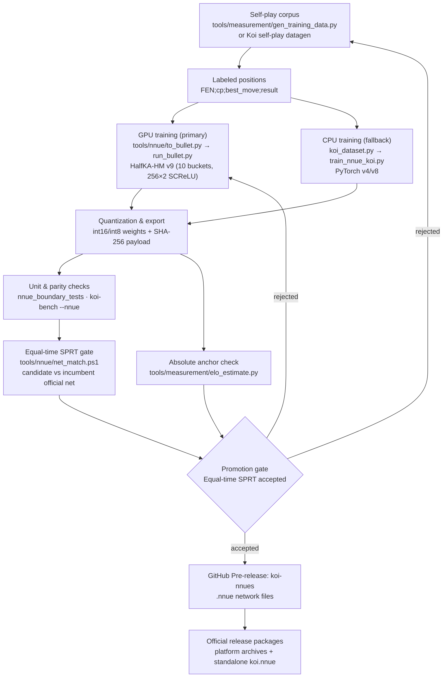

# NNUE Training and Promotion Pipeline

NNUE is Koi's default and production evaluator (a clean hand-crafted classical evaluator is also available via `EvalMode=hce` or `KOI_EVALUATOR=hce` for development and measurement). This guide documents the end-to-end pipeline that turns self-play corpora into a quantized, SPRT-gated `.nnue` network shipped in Koi releases.

## Stages

| Stage | Tool | Output |
| :--- | :--- | :--- |
| Data generation | `tools/measurement/gen_training_data.py` or Koi self-play | `FEN;cp;best_move;result` corpora |
| Bullet packing | `tools/nnue/to_bullet.py` | Binary Bullet dataset (with WDL outcome blend) |
| GPU training (primary) | `tools/nnue/run_bullet.py` (`tools/nnue/bullet_train/`) | HalfKA-HM v9 SCReLU checkpoint & quantized `.nnue` |
| CPU training (fallback) | `tools/measurement/koi_dataset.py` + `train_nnue_koi.py` | Float `.pt` checkpoint + quantized `.nnue` |
| Unit & throughput check | `nnue_boundary_tests`, `koi-engine nnue`, `koi-bench --nnue` | Scalar/AVX2/NEON parity, checksum verification, and NPS validation |
| Equal-time SPRT gate | `tools/nnue/net_match.ps1` / `uci_match.ps1` | Paired color-reversed match & pentanomial LLR |
| Absolute Elo check | `tools/measurement/elo_estimate.py --koi-eval-file` | Stockfish `UCI_Elo` anchor ladder report |

## Current Official Network (v9)

The current development and next-release official network is a **v9 `halfka-hm-v2` SCReLU** network:

| Property | Value |
| :--- | :--- |
| **Filename** | `koi-v9-hm10-h256-official.nnue` |
| **Container** | `KOI-NNUE` v9 (`halfka-hm-v2`, `qa=255`, `qb=64`, `eval_scale=400`) |
| **Architecture** | `7680 → 256×2 (SCReLU) → 1` across 10 horizontally-mirrored king buckets and 8 piece-count output buckets |
| **Runtime caching** | 20-slot `(bucket, mirror)` Finny table with fused AVX-512 / AVX2 / ARM NEON int16 accumulators |
| **SHA-256** | `bfb2470c87115af1b689802873608f14f15d087901b4adfca723184e985aec42` |
| **Download** | [Koi NNUEs release hub](https://github.com/nhatquang1701/Koi/releases/tag/koi-nnues) |
| **Strength delta** | **+180+ Elo** over the v1.2.0 bundled `koi-v7-h128-official-20261025.nnue` in equal-time self-play |

## Historical Milestone: First Official Network (v7, 2026-10-25)

Bundled in Koi **v1.1.5** through **v1.2.0**:

- **File:** `koi-v7-h128-official-20261025.nnue` (v4 container, 2,360,459 bytes, 128 hidden units, 12 king buckets, 8 output buckets, SHA-256 `0bb8d25e871fefeede3c1d00c563815510133f1daca9191638ea74d82ebba6b3`).
- **Role:** Established Koi as an NNUE-primary engine (`+134 Elo` vs classical at equal time) and carried Koi v1.2.0 to **2727 Elo** against Stockfish 19 `UCI_Elo` anchors before being superseded by the v9 `halfka-hm-v2` 256×2 SCReLU architecture.

## Promotion Rules

- **Equal-time gating is mandatory.** Node-limited matches cannot promote a network on their own because wider layers can tie at equal nodes while losing at equal time due to higher evaluation cost.
- **One variable at a time.** Isolate architecture, dataset composition, WDL blend, or quantization changes so rejected runs diagnose a single cause.
- **Hash-tied evidence.** Every local gate report records the candidate and incumbent SHA-256 hashes, engine binary, UCI options, opening book, and time control.
- **Release assets policy.** Binary `.nnue` files are never committed to Git branches. Public official networks are published as `.nnue` files on the [koi-nnues](https://github.com/nhatquang1701/Koi/releases/tag/koi-nnues) pre-release and bundled flat as `koi.nnue` inside official platform release archives (without `.metadata.json` or `.sha256` clutter in the GitHub Releases Assets tab).
