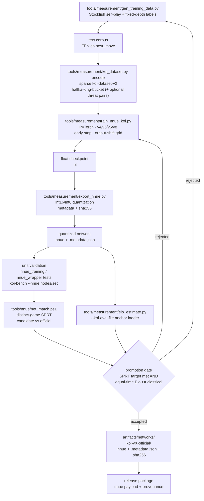

# NNUE training and promotion loop

NNUE is the primary evaluator in release packages (the classical evaluator is a
deprecated fallback, removed after at least one NNUE-primary release). This page
shows the loop that turns self-play data into a promoted `.nnue` file bundled in
release packages, with the exact tools in this repository.

## Stages

| Stage | Tool | Output |
| --- | --- | --- |
| Data generation | `tools/measurement/gen_training_data.py` | Text corpus (`FEN;cp;best_move`). |
| Corpus encoding | `tools/measurement/koi_dataset.py encode` | Sparse `koi-dataset-v2` binary. |
| Training | `tools/measurement/train_nnue_koi.py` | Float checkpoint (`.pt`) plus training metadata. |
| Quantization | `tools/measurement/export_nnue.py` | `int16/int8` `.nnue` file and metadata JSON. |
| Unit validation | `tests/python/evaluation/*`, `koi-bench --nnue` | Fast parity and throughput checks. |
| Relative gate | `tools/nnue/net_match.ps1` | Distinct-game SPRT report. |
| Absolute gate | `tools/measurement/elo_estimate.py --koi-eval-file` | Anchor-ladder Elo estimate. |
| Promotion | `artifacts/networks/koi-vX-official/` | Network, metadata, checksum. |

## Promotion rules

- A network is promoted only when the relative SPRT accepts **and** the
  absolute estimate shows it at least matches the classical evaluator at equal
  time. A network that is weaker is rejected even if it is faster.
- Evidence is hash-tied: the report records the network SHA-256, engine
  executable, options, openings, and time control.
- The official network directory carries the `.nnue`, its metadata, and a
  `.sha256` sidecar; release packages copy that payload with provenance.
- Training changes are one variable at a time (architecture, data size, or
  shift grid), so a rejected run points at a single cause.
- **Node-limited matches cannot promote a network on their own.** A wider hidden
  layer is equal at equal nodes and loses at equal time because it doubles eval
  cost: the 1024-wide v8 candidate measured 48.75-49.00% against the 512-wide
  official net at equal nodes but only 50.78% against the classical evaluator at
  equal time, where the official net scores 62.50%. Always run the equal-time
  gate before promoting.
- The version-8 container accepts both layouts: the halfka-only 9216-input
  payload (identical bytes to v4, written by `--arch v8`) and the 36864-input
  `threat-pairs-v1` form written by `--arch v6`. The input width selects the
  layout. The threat form lost every match it entered (33.75% against the
  official net) and its export saturates the L1 head, so it is not the default.

## Promoted network (2026-10-25)

The first NNUE-primary promotion is a v4-container halfka network:

- file: `koi-v7-h128-official-20261025.nnue` (2,360,459 bytes, 128 hidden,
  8 output buckets, SHA-256
  `0bb8d25e871fefeede3c1d00c563815510133f1daca9191638ea74d82ebba6b3`);
- trained on the 29.9M-row `p2big-dataset-v1` corpus for 10 epochs
  (validation MAE 137.6 cp); it is faster than the classical evaluator on the
  local bench, so 128 hidden was chosen over the larger 256/512 nets;
- equal-time gate (200 ms, NNUE side vs classical side): **68.4 % over 144
  games** (74 W / 49 D / 21 L on two opening sets), point estimate **+134 Elo**,
  95 % CI on score 0.604–0.754;
- absolute check: pending the SF1600 run; the 256-hidden sibling scored 65.0 %
  vs Stockfish 19 `UCI_Elo=1600` where the classical baseline scored 34.0 %
  (unpaired, SF-limited play is noisy);
- shipped inside release archives at `nnue/koi.nnue`; the engine discovers it at
  boot and advertises `EvalFile` default `<autodiscovery>`. The classical
  evaluator remains the deprecated fallback until removal.

The network file is a local artifact under `artifacts/networks/` and is not
committed; release packaging requires it plus its accepted `koi-nnue-gate-v1`
report (`-ReleasePackage -NnuePath -NnueGateReport`).